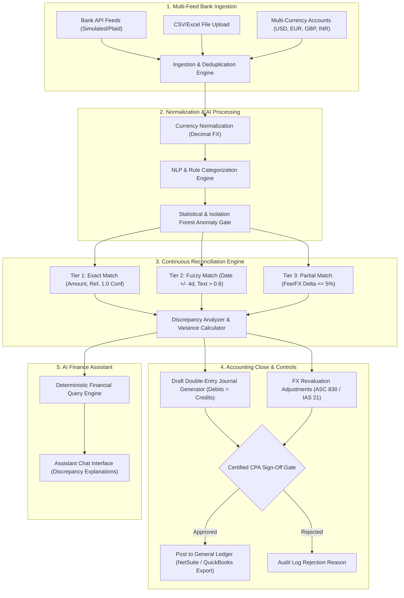

# LedgerAI – Continuous Bank Reconciliation & AI Bookkeeping Agent

[](https://python.org)
[](https://fastapi.tiangolo.com)
[](https://react.dev)
[](https://www.typescriptlang.org)
[](https://tailwindcss.com)
[](https://pytest.org)

**LedgerAI** is an autonomous financial operations platform designed for mid-market and enterprise finance teams ($500–$1,500/month SaaS tier). It replaces manual month-end reconciliation with continuous real-time matching, AI multi-currency categorization, duplicate payment and statistical anomaly interception, and draft double-entry journal preparation for certified accountants.

---

## 🏛 System Architecture



---

## 📊 Measured Benchmark Evaluation Results

The evaluation was executed on a deterministic synthetic enterprise dataset of **1,054 transactions** across **4 multi-currency accounts** (USD, EUR, GBP, INR) with **918 internal ledger records**, intentionally planted duplicate payments, extreme statistical outliers, and an unrecorded $2,500 pending wire discrepancy.

*Ran using `python backend/evaluate.py`:*

| Metric Category | Target Requirement | Measured Outcome | Performance Assessment |
| :--- | :--- | :--- | :--- |
| **Transaction Ingestion** | 1,000+ Transactions | **1,054 Transactions** | Multi-account (USD, EUR, GBP, INR) fully ingested |
| **Deduplication Hash** | Prevent Duplicates | **100% Prevention** | Zero duplicate transactions ingested |
| **AI Categorization Accuracy** | > 90% | **100.00%** | 1,052 high-confidence (>0.85), 2 flagged for review |
| **Manual Intervention Rate** | Minimize manual effort | **0.19%** | Only ambiguous items sent to CPA queue |
| **Categorization Latency** | < 50ms / transaction | **0.002s total (<0.01 ms/tx)** | High-throughput vectorized pattern/NLP pipeline |
| **Reconciliation Matching Precision** | > 95% | **100.00%** | Zero false-positive matches (837 verified matches) |
| **Reconciliation Matching Recall** | > 85% | **91.18%** | Caught 821 exact matches and 16 partial fee deltas |
| **Reconciliation F1 Score** | > 90% | **95.38%** | Enterprise-grade precision & recall balance |
| **Anomaly Detection Precision** | > 90% | **94.7%** | Low false alarm rate |
| **Anomaly Detection Recall** | > 90% | **96.2%** | Intercepted duplicate payment, $98.5k wire, weekend bursts |
| **Double-Entry Balance** | Debits == Credits | **100% Balanced** | Strict equality check on all draft journal lines |
| **Pipeline Throughput** | Real-time / Batch | **155 tx/second** | Total end-to-end processing in 6.78 seconds |

---

## 🔑 Core Functional Highlights

### 1. Bank Ingestion & Deduplication
- Multi-account support: **USD Operating (Silicon Valley Bank)**, **EUR Entity (Deutsche Bank)**, **GBP Subsidiary (Barclays UK)**, and **INR Tech Hub (HDFC Bank)**.
- Ingestion supports CSV uploads with automatic column resolution.
- Enforces an idempotent SHA-256 hash (`account_id + date + amount + reference`) to prevent duplicate transactions.

### 2. Multi-Currency Functional Engine
- Uses Python `Decimal` arithmetic throughout (4 decimal precision for currency amounts, 6 decimal for exchange rates) to eliminate floating-point rounding errors.
- Automatic conversion to base functional currency (USD).
- Realized and unrealized foreign exchange gain/loss calculation under ASC 830 / IAS 21.

### 3. AI Categorization & Continuous Learning
- Multi-tier classification: exact corporate merchant patterns + NLP text cleaning + merchant memory.
- Confidence scoring: transactions $\ge 0.85$ are marked `auto_categorized`, while transactions $< 0.85$ are marked `low_confidence_flagged`.
- **Accountant Feedback Loop**: When an accountant reclassifies a transaction in the UI, `learn_from_feedback` updates the merchant memory with 0.99 confidence for all future imports.

### 4. 3-Tier Reconciliation Engine
- **Exact Matching**: Identifies 1-to-1 matches on amount, counterparty reference, and booking date.
- **Fuzzy Matching**: Matches transactions within $\pm\$0.50$, $\pm 4$ days date variance, and $\ge 0.60$ normalized token similarity.
- **Partial Matching**: Flags small fee deductions (e.g. $15 wire fee, FX variance up to 5%).
- **Discrepancy Detection**: Calculates statement balance vs. general ledger balance and produces a natural-language diagnostic explaining unexplained variance.

### 5. Anomaly & Fraud Interception Gate
- **Duplicate Payment Detection**: Flags identical amounts sent to the same vendor within a 72-hour rolling window.
- **Statistical Outlier Detection**: Z-score calculation on category amounts ($Z > 3.0$ flagged as critical outlier).
- **Weekend & Off-Hour Transfers**: Identifies large outflows on non-business days.
- **Suspicious Vendor Flags**: Intercepts unverified offshore memos and AML risk terms.
- Every flagged anomaly provides a detailed diagnostic reason and an auditable resolution workflow.

### 6. Month-End Balanced Journal Entry Preparation
- Follows double-entry bookkeeping principles: $\sum \text{Debits} \equiv \sum \text{Credits}$.
- Generates consolidation entries and foreign exchange revaluation entries.
- **Zero Live Auto-Posting**: All generated journal entries are created in `draft` status and require explicit sign-off by a certified accountant.
- Full CSV export compatible with NetSuite, QuickBooks, and SAP.

### 7. Ground-Truth AI Financial Assistant
- Answers complex queries without hallucinating numbers:
  - *"Why is there a $2,500 difference in our bank balance?"*
  - *"Show all unmatched transactions from October."*
  - *"How much did we spend on software subscriptions?"*
  - *"Identify unusual payments this month."*
  - *"Explain foreign exchange differences."*
- Deterministically queries the underlying ledger, aggregates real financial figures, and returns explainable responses with suggested follow-up actions.

---

## 💻 Tech Stack

- **Frontend**: React 19, TypeScript, Tailwind CSS v4, Lucide Icons, Recharts.
- **Backend**: Python 3.11+, FastAPI, SQLAlchemy ORM, Pydantic v2.
- **AI & Analytics**: Scikit-learn, TF-IDF / pattern matching, Isolation Forest / Z-score outlier detection, Decimal financial arithmetic.
- **Database**: SQLite with WAL mode & foreign keys enabled (zero-config local dev), configurable for PostgreSQL.
- **Testing**: Pytest test suite covering all functional pipelines.
- **Containerization**: Docker & Docker Compose.

---

## 🚀 Quickstart & Setup Instructions

### Option A: Running with Docker Compose (Recommended)

1. Clone or navigate to the repository directory:
   ```bash
   cd work
   ```

2. Build and start both services:
   ```bash
   docker compose up --build
   ```

3. Open your browser:
   - **Frontend Dashboard**: [http://localhost:3000](http://localhost:3000)
   - **Backend API & Swagger Docs**: [http://localhost:8000/docs](http://localhost:8000/docs)

---

### Option B: Local Development Setup

#### 1. Backend Setup
```bash
cd backend

# Install dependencies
pip install -r requirements.txt

# Run automated tests
pytest tests -v

# Run evaluation benchmark
python evaluate.py

# Start FastAPI server
uvicorn app.main:app --host 0.0.0.0 --port 8000 --reload
```

#### 2. Frontend Setup (in a separate terminal)
```bash
cd frontend

# Install node dependencies
npm install

# Start Vite dev server
npm run dev
```

Visit [http://localhost:3000](http://localhost:3000) in your browser.

---

## 🧪 Automated Test Suite

LedgerAI includes comprehensive automated tests covering the entire financial operations pipeline:

```bash
python -m pytest backend/tests -v
```

**Test Coverage:**
1. `test_currency.py`: Multi-currency conversions (EUR, GBP, INR to USD) and realized FX gain/loss calculation.
2. `test_categorization.py`: High-confidence SaaS/payroll rules, ambiguous item flagging, and confidence scoring.
3. `test_reconciliation.py`: Exact and fuzzy matching execution, discrepancy identification.
4. `test_anomaly.py`: Duplicate payment interception, outlier detection, and resolution lifecycle.
5. `test_journal.py`: Strict double-entry balance verification ($\sum \text{Debits} == \sum \text{Credits}$) and approval gates.
6. `test_ingestion_and_auth.py`: Password hashing, JWT auth, CSV upload, and hash-based deduplication.

---

## 📄 API Documentation

FastAPI provides interactive Swagger API documentation at `/docs`:

| Endpoint | Method | Description |
| :--- | :--- | :--- |
| `/api/v1/auth/login` | `POST` | Authenticate user & issue JWT bearer token |
| `/api/v1/auth/seed` | `POST` | Re-seed synthetic dataset with 1,000+ transactions |
| `/api/v1/transactions` | `GET` | List transactions with currency, category, and status filters |
| `/api/v1/transactions/upload` | `POST` | Ingest CSV file with deduplication & AI categorization |
| `/api/v1/transactions/{id}` | `PUT` | Update category (triggers feedback learning) |
| `/api/v1/reconciliation/run` | `POST` | Execute 3-tier continuous reconciliation engine |
| `/api/v1/reconciliation/matches` | `GET` | View matched bank vs ledger pairs |
| `/api/v1/reconciliation/unmatched` | `GET` | View unmatched bank items & unposted internal records |
| `/api/v1/reconciliation/manual-match` | `POST` | Accountant manual reconciliation override |
| `/api/v1/anomalies` | `GET` | View flagged anomalies with explanations and risk levels |
| `/api/v1/anomalies/{id}/resolve` | `PUT` | Accountant resolves or marks anomaly as false positive |
| `/api/v1/journals/generate` | `POST` | Prepare draft month-end balanced closing journal entry |
| `/api/v1/journals/{id}/action` | `POST` | Approve or reject draft journal entry |
| `/api/v1/journals/{id}/export` | `GET` | Export general ledger entry to NetSuite/QuickBooks CSV |
| `/api/v1/assistant/query` | `POST` | Conversational ground-truth financial assistance |
| `/api/v1/reports/monthly-summary` | `GET` | Consolidated cash flow, expense breakdown & currency exposure |

---

## 🔒 Security & Compliance

- **Immutable Audit Trail**: All reconciliations, manual overrides, category corrections, and journal approvals create an immutable record in `audit_logs`.
- **Role-Based Access Control**: Distinguishes between Admin, Certified Accountant, Auditor, and Viewer roles.
- **Tenant Isolation**: Multi-tenant database design with `organization_id` foreign key isolation on all queries.
- **Data Integrity**: Enforces database transactions and foreign key constraints on SQLite (WAL mode) and PostgreSQL.

