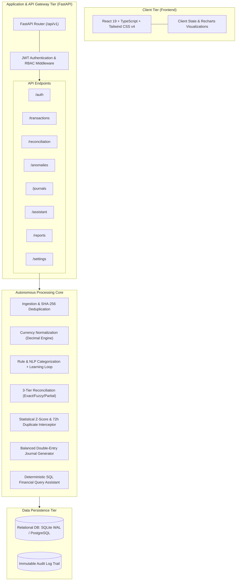
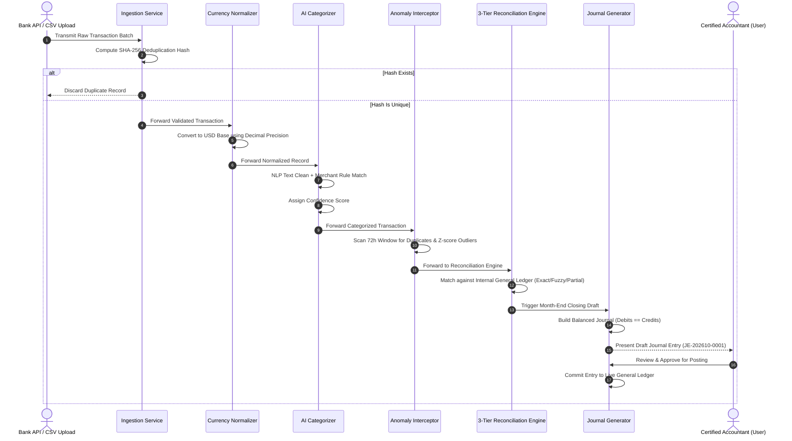
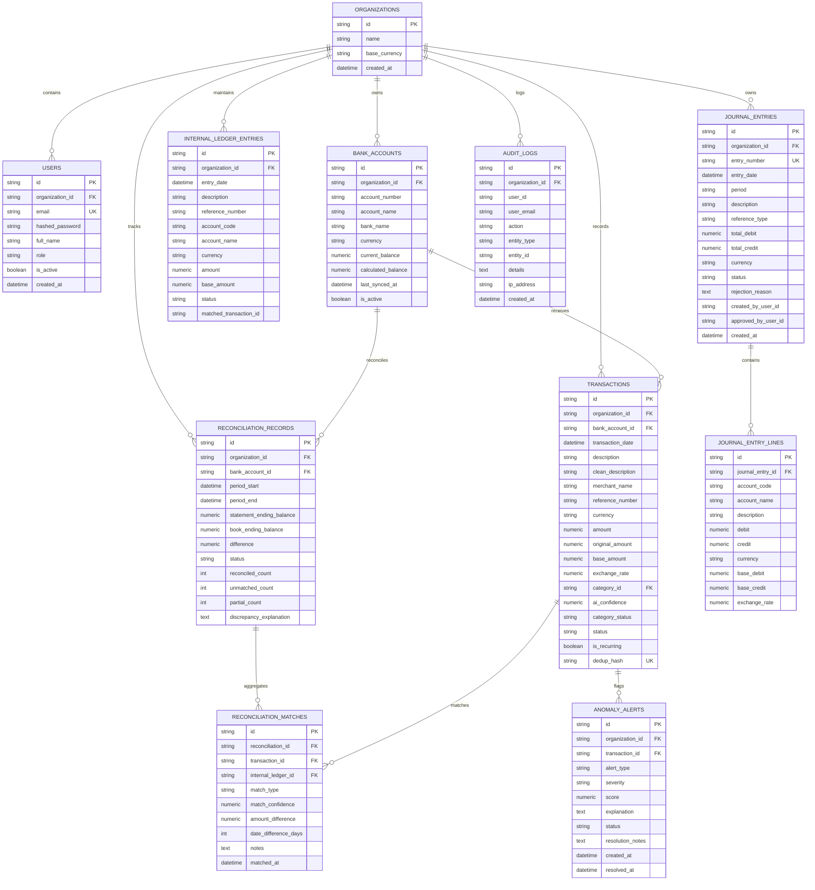

# System Architecture & Technical Specifications
# LedgerAI – Continuous Bank Reconciliation & Bookkeeping Agent
## Phase 1 Milestone: 45% Scope Baseline

---

## 1. High-Level System Architecture

The LedgerAI platform is structured as a decoupled, multi-tenant financial automation application comprising an asynchronous FastAPI backend and a responsive React 19 / TypeScript single-page application:

---

## 2. Autonomous Financial Pipeline Sequence

The pipeline executes continuously as new transactions arrive:

---

## 3. Database Entity-Relationship Diagram (ERD)

The database schema is fully normalized and enforces referential integrity:

---

## 4. Multi-Currency Calculation Logic (ASC 830 / IAS 21)

All currency operations use Python `Decimal` to avoid binary floating-point rounding issues:

### 4.1 Cross-Rate Formula
$$\text{Applied Rate} = \frac{\text{Rate}(\text{From Currency} \to \text{USD})}{\text{Rate}(\text{To Currency} \to \text{USD})}$$
$$\text{Base Amount (USD)} = \text{Round}\Big(\text{Original Amount} \times \text{Applied Rate},\; 4\text{ decimals}\Big)$$

### 4.2 Realized FX Gain/Loss Formula
When settling a foreign payable or receivable, the gain or loss in USD is:
$$\Delta_{\text{FX}} = \text{Original Amount} \times (\text{Settlement Rate} - \text{Booking Rate})$$
* If $\Delta_{\text{FX}} > 0$: **Realized Foreign Exchange Gain** (Credit Revenue Account 8200).
* If $\Delta_{\text{FX}} < 0$: **Realized Foreign Exchange Loss** (Debit Expense Account 8100).

---

## 5. Security & Audit Logging Architecture

Every mutation to the financial state is captured in the immutable `audit_logs` table:
* **Capture Attributes:** User UUID, User Email, Timestamp (UTC), Action (`CREATE`, `UPDATE`, `APPROVE`, `REJECT`, `RECONCILE`, `OVERRIDE`), Entity Type, Entity ID, and detailed context.
* **Separation of Duties:** Approval requests enforce that the accountant approving a journal entry or manual override cannot bypass balanced debit/credit validation rules.

