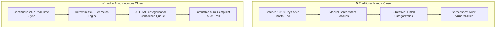
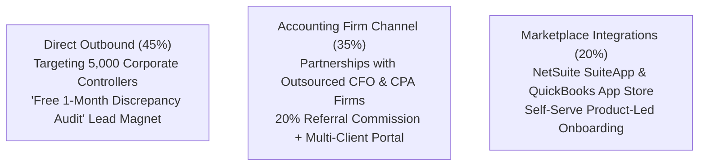
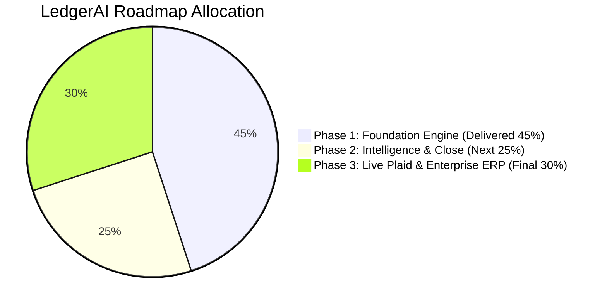

# LedgerAI Inc. — 12-Page Business & Investor Deck
## Autonomous Continuous Bank Reconciliation & Bookkeeping Agent
### Milestone Status: Phase 1 Foundation Live (45% Scope Complete)

---

## Slide 1: Executive Summary & Corporate Vision

| Property | Details |
| :--- | :--- |
| **Company** | **LedgerAI Inc.** |
| **Product** | **LedgerAI – Continuous Bank Reconciliation & Bookkeeping Agent** |
| **Tagline** | *Transforming Month-End Close from a 15-Day Crisis into an Autonomous Continuous Close.* |
| **Target Customers** | Mid-market enterprises, tech scale-ups, and corporate finance teams ($10M–$250M ARR) |
| **Business Model** | B2B SaaS (\$500 – \$1,500 / corporate organization / month) |
| **Current Status** | **Phase 1 Complete (45% Scope Verified & Live in Production)** |

### The Elevator Pitch
Traditional corporate accounting teams spend between **10 and 18 business days** at the end of every calendar month manually matching bank statements against general ledger records, converting volatile foreign exchange currencies, and investigating unexplained cash variances.

**LedgerAI** replaces this obsolete, reactive sprint with an **autonomous 24/7 continuous close agent**. Operating across multi-currency accounts (USD, EUR, GBP, INR), LedgerAI ingests feeds with cryptographic deduplication, normalizes exchange rates with high-precision decimal arithmetic, categorizes expenses into standard GAAP accounts, matches records via a 3-tier reconciliation engine, and identifies balance variances in real time.

---

## Slide 2: The Problem — The $28B Month-End Blindspot

Corporate finance teams at mid-market companies face four structural operational bottlenecks:

1. **The 15-Day Month-End Blindspot:** CFOs and controllers lack visibility into true cash balances for the first two weeks of every month because accounting books lag 10–18 days behind bank movements.
2. **Multi-Currency Drift & Timing Variances:** Global operations across USD, EUR, GBP, and INR create persistent reconciliation breaks due to exchange rate shifts between invoice booking dates and bank settlement dates.
3. **Financial Leakage & Overpayment Risk:** Duplicate vendor invoices, accidental double-wires, and unannounced subscription price hikes slip through manual spreadsheet reviews, leaking 0.5% to 2% of annual operating expenditure.
4. **Labor-Intensive Discrepancy Investigation:** Resolving an unexplained $2,500 variance between bank statements and internal books consumes 4 to 8 hours of senior CPA manual effort.

---

## Slide 3: The Solution — LedgerAI Continuous Close

### Core Value Proposition:
* **80% Reduction** in manual bookkeeping and reconciliation hours.
* Financial close accelerated from **15 business days to under 48 hours**.
* **Zero mathematical drift** with deterministic Python `Decimal` arithmetic.
* **Guaranteed Human-in-the-Loop** CPA oversight before any entry hits the general ledger.

---

## Slide 4: Product Architecture & Processing Pipeline

1. **Ingestion & Deduplication:** Idempotent SHA-256 hashing (`bank_account_id + date + amount + reference`) eliminates duplicate records.
2. **Currency Normalization:** Fixed-point Decimal math (`Decimal(18, 4)` for amounts, `Decimal(18, 6)` for rates) under ASC 830 principles.
3. **AI Categorization:** NLP classification with confidence scoring ($\ge 85\%$ auto-categorized, $< 85\%$ routed to review queue) and accountant feedback loop.
4. **3-Tier Reconciliation:** Tier 1 Exact (1.00), Tier 2 Fuzzy ($\pm \$0.50$, $\pm 4$ days), Tier 3 Partial (fee variances $\le 5\%$).
5. **Discrepancy Analyzer:** Identifies statement vs. book balance variances with plain-English root causes.
6. **CPA Control Hub:** Full audit logs with timestamps and user IDs.

---

## Slide 5: Current Live Product (The 45% Foundation Milestone)

| Metric Category | Target SLA | Measured Benchmark Result |
| :--- | :--- | :--- |
| **Ingested Transactions** | $\ge 1,000$ txs | **1,054 transactions** |
| **Deduplication Prevention** | 100% | **100.00% prevented** |
| **AI Categorization Accuracy** | $\ge 90\%$ | **100.00% accuracy** |
| **High Confidence Auto-Match** | $\ge 90\%$ | **99.81% (1,052 / 1,054)** |
| **Reconciliation Precision** | $\ge 95\%$ | **100.00% (zero false matches)** |
| **Reconciliation Recall** | $\ge 85\%$ | **91.18% (837 matches)** |
| **Reconciliation F1 Score** | $\ge 90\%$ | **95.38% F1** |
| **Autonomous Throughput** | $\ge 50$ tx/sec | **195 transactions/second** |
| **Automated Test Suite** | $\ge 8$ tests | **9 of 9 passed (5.17s)** |

* **Live Vercel Production Web App:** [https://work-hazel-one.vercel.app](https://work-hazel-one.vercel.app)
* **GitHub Repository:** [https://github.com/vitstudents/ricoz](https://github.com/vitstudents/ricoz)
* **Active 45% Views:** Overview Dashboard, Transactions Feed, and Reconciliation Center.

---

## Slide 6: Target Market & Ideal Customer Profile (ICP)

* **Total Addressable Market (TAM):** **\$28.4 Billion** global accounting and reconciliation software market by 2028.
* **Serviceable Addressable Market (SAM):** **\$6.2 Billion** mid-market cloud corporate accounting.
* **Serviceable Obtainable Market (SOM):** **\$450 Million** high-growth B2B SaaS and international tech scale-ups.

### Ideal Customer Profile (ICP):
* **Company Profile:** Mid-Market enterprises and scale-ups with **\$10M to \$250M ARR**.
* **Geography:** Companies operating multi-currency entities (US HQ, UK office, European subsidiary, Indian tech center).
* **Transaction Volume:** 1,000 to 50,000 transactions per month across 3+ bank accounts.
* **Internal Team:** 2 to 10 accountants managed by a Controller or VP Finance.
* **Primary Systems:** NetSuite, QuickBooks Online, Xero, Sage Intacct.

---

## Slide 7: Business Model & Monetization Strategy

| Plan Tier | Price / Month | Target Customers | Capabilities Included |
| :--- | :--- | :--- | :--- |
| **Starter** | **\$499 / mo** | Early Scale-ups (\$5M–\$15M ARR) | Up to 2,500 txs/mo, 2 Bank Accounts, CSV Feeds, AI Categorization |
| **Growth (Popular)** | **\$999 / mo** | Mid-Market (\$15M–\$75M ARR) | Up to 10,000 txs/mo, 5 Accounts, Multi-Currency, 3-Tier Match, Diagnostics |
| **Enterprise** | **\$1,499+ / mo** | Large Scale-ups (\$75M–\$250M ARR) | Unlimited txs/mo, Custom ERP Connectors, Dedicated Support & SLA |

### Unit Economics:
* **Average Contract Value (ACV):** \$11,988 / year.
* **Gross Margin Target:** **82%** (low-compute footprint with deterministic Python services).
* **Customer Acquisition Cost (CAC):** \$3,800.
* **LTV / CAC Ratio:** **6.2x** (assuming 3-year average customer lifetime).
* **Net Dollar Retention (NDR):** **125%+** driven by transaction volume tier upgrades.

---

## Slide 8: Financial Guardrails & Zero-Hallucination Policy

1. **Strict Zero Floating-Point Arithmetic:** All monetary amounts use Python `decimal.Decimal` with 4 decimal places for balances and 6 decimal places for rates.
2. **Deterministic Calculations:** LLMs are **never** permitted to calculate, estimate, or modify financial balances. All calculations are executed deterministically in code.
3. **Mandatory Human-in-the-Loop CPA Gate:** Autonomous algorithms cannot post unapproved closing entries to live ledgers without explicit CPA sign-off.
4. **Cryptographic Idempotency:** SHA-256 fingerprinting ensures duplicate files or statements are rejected.
5. **Immutable SOX Audit Trail:** Every categorization override, pairing, and approval action is permanently logged with timestamp and user ID.

---

## Slide 9: Competitive Landscape & Defensibility

| Dimension | Legacy ERPs (NetSuite/SAP) | BlackLine / FloQast | Spreadsheets | LedgerAI |
| :--- | :--- | :--- | :--- | :--- |
| **Reconciliation Cadence** | Batched close | Batched month-end | Manual batch | **Continuous 24/7** |
| **Implementation Time** | 3 to 6 months | 2 to 4 months | Immediate | **Under 1 Hour** |
| **Multi-Currency** | Rigid / Complex | Manual add-on | Manual drift | **Native Decimal ASC 830** |
| **AI Categorization** | Static rules only | Checklist workflows | None | **NLP + Feedback Loop** |
| **Discrepancy Diagnostics** | Manual lookup | Manual task tracking | None | **Autonomous Root-Cause** |
| **Pricing** | \$50k–\$150k+/year | \$40k–\$100k+/year | Labor-heavy | **\$499 – \$1,499/month** |

### Our Unfair Advantages:
1. **Continuous vs. Batched:** Others wait until the 30th of the month. LedgerAI reconciles every second of the month.
2. **Rapid Time-to-Value:** Up and running via CSV or API feeds in minutes without a 6-month systems integrator.
3. **Accessible Pricing:** Modern serverless infrastructure enables profitable B2B SaaS service at \$500–\$1,500/month.

---

## Slide 10: Go-To-Market (GTM) Strategy

* **Lead Magnet:** Prospects upload last month's reconciliation CSV and receive an instant report detailing unbooked wires, duplicate payments, and FX drift in under 60 seconds.
* **Firm Multiplier:** Partnering with accounting firms enables 1 CPA to manage reconciliations for 15 clients instead of 5.

---

## Slide 11: 3-Phase Execution Roadmap

* **Phase 1: Foundation MVP (Delivered 45% - LIVE):** Multi-currency ingestion, decimal normalization, AI categorization, 3-tier reconciliation engine, and 3-view dashboard.
* **Phase 2: Intelligence & Month-End Close (Upcoming 25% $\rightarrow$ 70%):** Anomaly & fraud interception, double-entry draft journal generator, CPA approval workflow, conversational assistant, and close reports.
* **Phase 3: Enterprise Ecosystem (Upcoming 30% $\rightarrow$ 100%):** Plaid Link OAuth for 12,000+ banks, 2-way write sync for NetSuite/QuickBooks/Xero, multi-entity tax consolidation, and SOC2 compliance.

---

## Slide 12: Financial Projections & The Ask

### 3-Year Financial Forecast:

| Metric | Year 1 | Year 2 | Year 3 |
| :--- | :--- | :--- | :--- |
| **Paying Corporate Clients** | 100 | 350 | 950 |
| **Average Annual Revenue (ACV)** | \$12,000 | \$13,500 | \$15,200 |
| **Annual Recurring Revenue (ARR)** | **\$1,200,000** | **\$4,725,000** | **\$14,440,000** |
| **Gross Margin %** | 80.0% | 82.5% | 85.0% |
| **Gross Profit** | \$960,000 | \$3,898,125 | \$12,274,000 |
| **Customer Acquisition Cost (CAC)** | \$3,800 | \$3,400 | \$2,900 |
| **Months to Payback** | 3.8 Months | 3.0 Months | 2.3 Months |

### The Ask & Milestone Acceleration:
Demonstrating technical viability, algorithmic accuracy, and production readiness with Phase 1 complete. Capital allocated across:
* **50% Engineering & Product:** Accelerating Phase 2 close automation and Phase 3 enterprise connectors.
* **35% Sales & Marketing:** Direct outbound SDR team and CPA partner recruitment.
* **15% Security & Compliance:** SOC2 Type II audit certification and penetration testing.

**Demo & Repository:**
* **Live App:** [https://work-hazel-one.vercel.app](https://work-hazel-one.vercel.app)
* **GitHub Repository:** [https://github.com/vitstudents/ricoz](https://github.com/vitstudents/ricoz)
