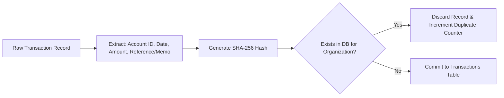
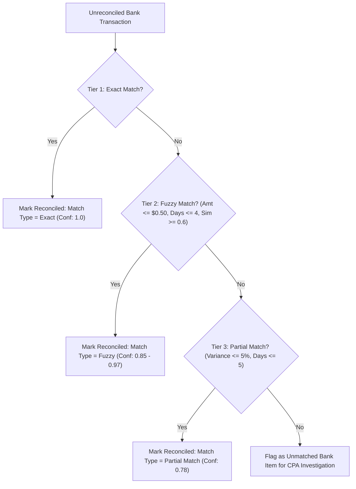

# Functional Specifications & Algorithm Guide
# LedgerAI – Continuous Bank Reconciliation & Bookkeeping Agent
## Phase 1 Milestone: 45% Scope Baseline

---

## 1. Idempotent Deduplication Engine

To prevent duplicate transactions when ingesting repeated bank statements or network retries, LedgerAI implements an idempotent hash gate:

### Algorithm Specification:
$$\text{Hash Input} = \text{BankAccountID} \,\|\, \text{Date(YYYY-MM-DD)} \,\|\, \text{Amount} \,\|\, \text{Reference}$$
$$\text{DedupHash} = \text{SHA256}(\text{Hash Input})$$
* **Database Constraint:** `Index("idx_org_tx_hash", "organization_id", "dedup_hash", unique=True)` guarantees zero duplicates at the storage level.

---

## 2. AI Categorization & Continuous Feedback Learning Loop

### 2.1 Description Tokenizer & Pre-processing
Raw bank memos contain card IDs, terminal numbers, and network codes (e.g. `POS DEBIT 4829 AWS EMEA INVOICE 992819 REF#882910`). 
1. Removes numbers $\ge 4$ digits (`[\*#\d]{4,}`).
2. Strips noise tokens: `pos`, `auth`, `card`, `purchase`, `ref`, `txn`, `ach`, `debit`, `payment`.
3. Normalizes whitespace and character case.

### 2.2 Classification Hierarchy
1. **Tier 1 (Learned Memory):** Checks for previous manual overrides by CPAs on the same counterparty. If found, assigns category with **$0.9900$ confidence**.
2. **Tier 2 (Corporate Merchant Rules):** Matches against verified accounting dictionaries:
   - Cloud Infrastructure: `aws`, `amazon web services`, `ec2` $\to$ `EXP-SFT-001` (Confidence: 0.98)
   - Payroll & Benefits: `gusto`, `adp`, `rippling`, `direct deposit` $\to$ `EXP-PAY-001` (Confidence: 0.99)
   - Coworking & Facilities: `wework`, `regus`, `office rent` $\to$ `EXP-FAC-001` (Confidence: 0.97)
   - Customer Revenue: `stripe payout`, `merchant deposit` $\to$ `REV-SAL-001` (Confidence: 0.98)
3. **Tier 3 (NLP Heuristics):** Ambiguous strings match semantic roots (e.g. `consulting`, `tech`, `legal`) with confidence $[0.60, 0.82]$.
4. **Fallback:** Unknown memos are assigned `EXP-UNC-000` (Uncategorized Expense) with confidence $0.4500$ and routed to the CPA review queue.

---

## 3. 3-Tier Reconciliation Matching Engine

Reconciliation continuously pairs bank transactions with internal general ledger entries.

### Matching Criteria Matrix:

| Match Tier | Amount Condition | Date Variance ($\Delta t$) | Text Similarity ($S$) | Confidence Assigned |
| :--- | :--- | :--- | :--- | :--- |
| **Tier 1: Exact** | $|\text{Bank} - \text{Ledger}| < 0.0001$ | $\le 2\text{ days}$ (or exact Ref) | $S \ge 0.50$ | **$1.0000$** |
| **Tier 2: Fuzzy** | $|\text{Bank} - \text{Ledger}| \le \$0.50$ | $\le 4\text{ days}$ | $S \ge 0.55$ | **$0.8500 - 0.9700$** |
| **Tier 3: Partial** | $\frac{|\text{Bank} - \text{Ledger}|}{|\text{Bank}|} \le 5\%$ | $\le 5\text{ days}$ | $S \ge 0.50$ | **$0.7800$** |

*Text similarity is computed using normalized token set intersection: $S = \frac{|T_1 \cap T_2|}{|T_1 \cup T_2|}$.*

---

## 4. Anomaly & Fraud Interception Algorithms

### 4.1 Duplicate Payment Interceptor
* **Window:** 72-hour forward-rolling lookahead.
* **Condition:**
  $$|\text{Amount}_1 - \text{Amount}_2| < 0.0001 \quad \text{AND} \quad \text{Merchant}_1 \equiv \text{Merchant}_2$$
* **Action:** Transaction 2 is flagged as `duplicate_payment` (Severity: High, Score: 0.92) with human-readable diagnostic message.

### 4.2 Statistical Z-Score Outlier Detector
For all debits within a category:
$$\mu = \frac{1}{N}\sum_{i=1}^N x_i, \qquad \sigma = \sqrt{\frac{1}{N}\sum_{i=1}^N (x_i - \mu)^2}$$
$$Z = \frac{x - \mu}{\sigma}$$
* If $Z > 3.0$: Flagged as `unusual_amount` (Severity: Critical if amount $> \$20,000$, High otherwise).

---

## 5. Double-Entry Balanced Journal Preparation

Every month-end close requires complete debit and credit equality:
$$\sum_{j} \text{Debit}_j \equiv \sum_{j} \text{Credit}_j$$

### Balancing Logic:
1. Aggregate net base amounts by category account code:
   - Outflows (Expenses): Debit Expense Account, Total Outflow.
   - Inflows (Revenues): Credit Revenue Account, Total Inflow.
2. Compute net cash movement: $\Delta_{\text{Cash}} = \sum \text{Debits} - \sum \text{Credits}$.
3. Create balancing line for `Account 1000 - Operating Cash`:
   - If $\Delta_{\text{Cash}} > 0$: Credit Operating Cash $\Delta_{\text{Cash}}$.
   - If $\Delta_{\text{Cash}} < 0$: Debit Operating Cash $|\Delta_{\text{Cash}}|$.
4. Set status to `draft`. The approval endpoint requires explicit human accountant sign-off.

