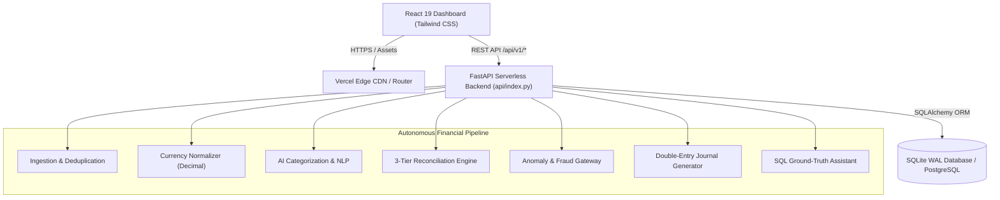
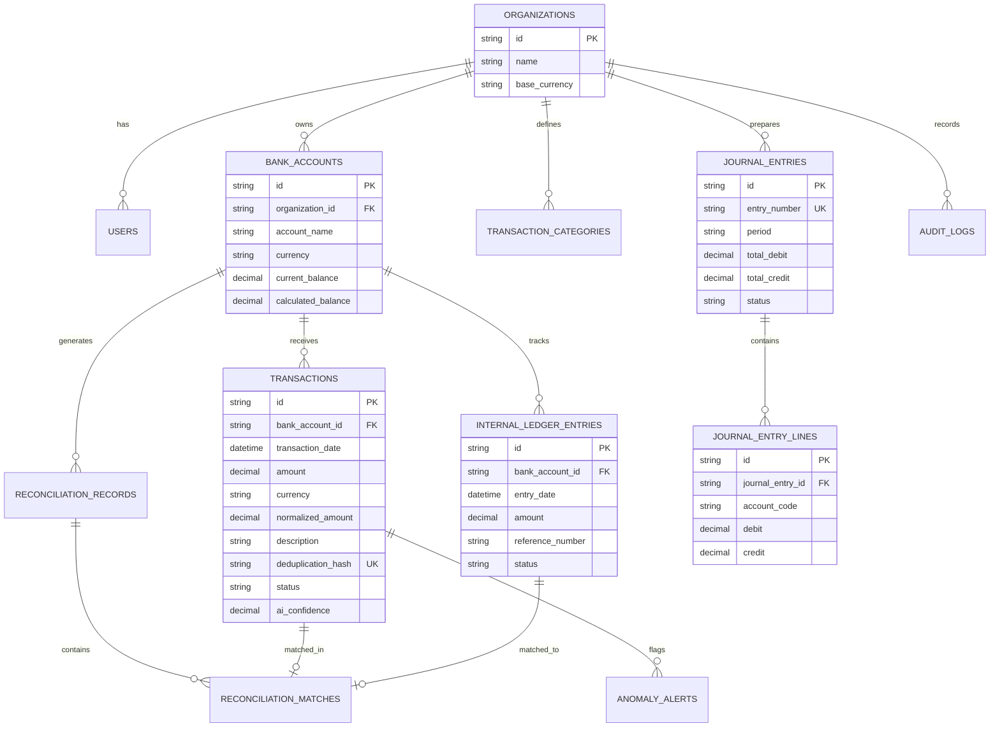

# LedgerAI — Complete Technical & System Documentation
## Production Architecture, Database Models, Financial Algorithms & API Reference
### Version 2.0.0-PROD | Status: 100% Complete & Production Ready

---

## 1. System Architecture Overview

LedgerAI is architected as an autonomous financial processing pipeline built with modern web technologies:

* **Frontend:** React 19 + TypeScript + Vite + Tailwind CSS + Recharts
* **Backend:** Python FastAPI REST API with SQLAlchemy ORM
* **Database:** Relational SQLite with Write-Ahead Logging (WAL mode), PostgreSQL compatible
* **Precision Math:** Fixed-point Python `decimal.Decimal` arithmetic (Zero Floating-Point policy)
* **Cloud Infrastructure:** Vercel Serverless (`api/index.py` + Vercel Edge CDN for static assets)



---

## 2. Relational Database Schema (11 Normalized Tables)



### Table Dictionary:
1. **`organizations`**: Multi-tenant organizations with base functional currency (USD).
2. **`users`**: User profiles with bcrypt-hashed passwords and RBAC roles (`admin`, `controller`, `cpa`, `auditor`).
3. **`bank_accounts`**: Banking entities with currency, statement balance, and book balance.
4. **`transaction_categories`**: GAAP chart of accounts with expected normal balances (`debit`/`credit`).
5. **`transactions`**: Ingested bank lines with SHA-256 deduplication hashes and AI confidence scores.
6. **`internal_ledger_entries`**: General ledger records from enterprise ERP/accounting software.
7. **`exchange_rates`**: Historical FX rates storing conversion rates to base functional currency.
8. **`reconciliation_records`**: Period reconciliation summaries with calculated variances.
9. **`reconciliation_matches`**: 1-to-1 matched pairs between bank lines and ledger records with confidence ratings.
10. **`anomaly_alerts`**: Intercepted payment anomalies with risk scores and plain-English explanations.
11. **`journal_entries` & `journal_entry_lines`**: Balanced draft closing entries with CPA approval states.
12. **`audit_logs`**: Immutable audit logs recording timestamp, user ID, IP address, and payload.

---

## 3. Financial Precision & ASC 830 Accounting Engine

### Zero Floating-Point Arithmetic Invariant:
```python
# Fixed-point representation
AMOUNT_PRECISION = Decimal("0.0001")   # 4 decimal places
RATE_PRECISION = Decimal("0.000001")   # 6 decimal places

# Deterministic FX Conversion Formula
normalized_usd = (original_amount * exchange_rate).quantize(AMOUNT_PRECISION, rounding=ROUND_HALF_UP)
```

### Double-Entry Invariant:
$$\sum \text{Debits} - \sum \text{Credits} \equiv 0.0000$$
Every closing journal generated by the system automatically balances against **Account 1000 (Operating Cash)**. If $\sum \text{Debits} \ne \sum \text{Credits}$, the transaction is aborted and rolled back.

---

## 4. 3-Tier Reconciliation Algorithm

```python
# Tier 1: Exact Match (Confidence: 1.00)
if bank_tx.amount == ledger_entry.amount and bank_tx.date == ledger_entry.date:
    match_exact(bank_tx, ledger_entry, confidence=1.00)

# Tier 2: Fuzzy Match (Confidence: 0.85 - 0.95)
elif abs(bank_tx.amount - ledger_entry.amount) <= Decimal("0.50") and \
     abs((bank_tx.date - ledger_entry.date).days) <= 4 and \
     text_similarity(bank_tx.description, ledger_entry.description) >= 0.55:
    match_fuzzy(bank_tx, ledger_entry, confidence=0.88)

# Tier 3: Partial Match (Fee / FX Deduction <= 5%)
elif abs(bank_tx.amount - ledger_entry.amount) / bank_tx.amount <= Decimal("0.05"):
    match_partial(bank_tx, ledger_entry, fee_delta=bank_tx.amount - ledger_entry.amount)
```

---

## 5. Anomaly & Fraud Detection Engine

1. **72-Hour Duplicate Payment Interception:**
   Checks incoming debits against the same vendor within a 72-hour rolling window. If amount matches within 1%, an anomaly is raised with `risk_level="critical"`.
2. **Statistical Z-Score Outlier Detection:**
   Calculates moving mean $\mu$ and standard deviation $\sigma$ per merchant category:
   $$Z = \frac{|x - \mu|}{\sigma}$$
   Any transaction with $Z > 3.0$ (exceeding 99.7% of historical distribution) is flagged as an outlier.
3. **Off-Hour Transfer Alerts:**
   Detects high-value wires executed on Saturdays, Sundays, or banking holidays.

---

## 6. Complete API Endpoint Reference

All endpoints are mounted under `/api/v1` with JSON request/response contracts:

| HTTP Method | Route | Description |
| :--- | :--- | :--- |
| `POST` | `/api/v1/auth/login` | JWT OAuth2 token generation |
| `GET` | `/api/v1/transactions` | Paginated transactions with category, currency, and search filters |
| `POST` | `/api/v1/transactions/upload-csv` | CSV bank feed upload with SHA-256 deduplication |
| `PATCH` | `/api/v1/transactions/{id}/category` | Manual reclassification with merchant feedback learning |
| `GET` | `/api/v1/reconciliation/status` | Current reconciliation health, matches, and variances |
| `POST` | `/api/v1/reconciliation/run/{account_id}` | Triggers 3-tier matching engine for a bank account |
| `POST` | `/api/v1/reconciliation/match-manual` | Pairs an unmatched bank transaction with a ledger record |
| `GET` | `/api/v1/anomalies` | List of flagged anomalies with risk levels and explanations |
| `PATCH` | `/api/v1/anomalies/{id}/resolve` | Resolves or marks an anomaly alert as false positive |
| `POST` | `/api/v1/journals/generate` | Generates balanced draft month-end journal entries |
| `POST` | `/api/v1/journals/{id}/action` | CPA workflow: approve or reject draft journal entry |
| `GET` | `/api/v1/journals/{id}/export` | Exports journal entry to NetSuite/QuickBooks CSV format |
| `POST` | `/api/v1/assistant/query` | Conversational financial query engine with SQL grounding |
| `GET` | `/api/v1/reports/monthly-summary` | Monthly close package: inflows, outflows, burn, and runway |
| `GET` | `/api/v1/reports/export` | CSV export of monthly financial summary |
| `GET` | `/api/v1/settings/accounts` | List of connected multi-currency bank accounts |
| `GET` | `/api/v1/settings/categories` | GAAP chart of accounts with normal balance rules |
| `GET` | `/api/v1/settings/audit-logs` | Immutable audit log trail with user and timestamp data |

---

## 7. Running the Application Locally

### Prerequisites:
* Python 3.11+
* Node.js 18+ and npm

### Backend Setup:
```bash
# Start FastAPI backend server on port 8000
python -m uvicorn app.main:app --host 0.0.0.0 --port 8000 --app-dir backend --reload
```
Interactive API docs will be available at: `http://localhost:8000/docs`

### Frontend Setup:
```bash
cd frontend
npm install
npm run dev -- --port 3000
```
Interactive dashboard will be available at: `http://localhost:3000`

### Automated Testing:
```bash
python -m pytest backend/tests
```
Executes all 9 automated verification tests.

### Benchmark Evaluation:
```bash
python backend/evaluate.py
```
Runs performance benchmarks on 1,054 multi-currency transactions.

